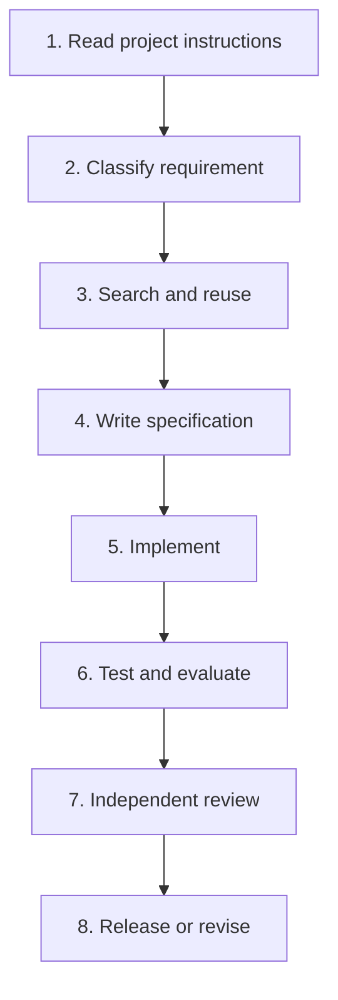

# Agent Platform Implementation Workflow

## Purpose

Use this document whenever an AI coding agent is asked to create or modify an MCP server, tool, skill, CLI command, gateway component, or related platform capability.

The standards package must be available in the target repository before implementation begins. Keep its folder structure unchanged so referenced paths remain valid.

## The required order



Do not reverse this order. In particular, do not implement first and attempt to retrofit policy, result limits, tests, evaluation, and approvals later.

---

## Phase 0 — Place the standards in the repository

1. Copy the complete `agent-platform-standards/` directory into the repository root, or merge its contents into the repository's established documentation structure while preserving all cross-references.
2. Keep `AGENTS.md` at the repository root or merge its rules into the existing root `AGENTS.md`.
3. Make the full directory available to the coding agent; do not provide only one isolated prompt.

The coding agent must always begin with:

- `AGENTS.md`
- `README.md`
- `docs/agent-platform/01-AGENT_PLATFORM_ARCHITECTURE.md`
- `docs/agent-platform/02-AGENT_ENGINEERING_PRINCIPLES.md`
- `docs/agent-platform/16-AGENT_REGISTRY_AND_DEPENDENCY_MAP_STANDARD.md`
- `docs/agent-platform/15-DECISION_TREES.md`

---

## Phase 1 — Intake and classification

Use this phase before creating or changing anything.

1. State the desired user outcome without assuming that the answer is an MCP, Tool, Skill, or script.
2. Identify domain, target, environment, evidence requirements, sensitive data, and possible side effects.
3. Ask only questions that materially change scope, permissions, architecture, or risk.
4. Search the Agent Registry, declared and observed dependency relationships, Capability Catalog, repository, skills, scripts, queries, resources, and ADRs.
5. For any component to be changed or reused, inspect its owner, lifecycle, version compatibility, and direct/transitive dependents.
6. Complete `templates/CAPABILITY_REQUEST_TEMPLATE.md`.
7. Apply the decision trees and choose the smallest correct classification.

Possible outcomes:

| Outcome | Next action |
|---|---|
| Existing artifact is sufficient | Reuse it; document the choice |
| Existing artifact plus deterministic processing | Reuse it and use Code Mode |
| No protected boundary; deterministic logic needed | Ordinary application code/library |
| Reusable protected backend operation | New or updated MCP Tool |
| Reusable multi-step procedure | New or updated Skill |
| One-off interpretation with sufficient evidence | Agent reasoning only |
| Ambiguous, unsafe, unsupported, or unauthorized | Stop, clarify, defer, or reject |

### Initial prompt to give the coding agent

```text
You are working in an enterprise agent-platform repository.

Requested outcome:
<INSERT THE USER'S REQUIRED OUTCOME, CONSTRAINTS, TARGETS, AND ACCEPTANCE CRITERIA>

Before designing or implementing anything, read and comply with:

- AGENTS.md
- README.md
- docs/agent-platform/01-AGENT_PLATFORM_ARCHITECTURE.md
- docs/agent-platform/02-AGENT_ENGINEERING_PRINCIPLES.md
- docs/agent-platform/16-AGENT_REGISTRY_AND_DEPENDENCY_MAP_STANDARD.md
- docs/agent-platform/15-DECISION_TREES.md

First classify the requested outcome using the decision trees.
Search the Agent Registry, declared and observed dependency map, repository, and
Capability Catalog for existing agents, MCP servers, tools, skills, models,
runtimes, scripts, queries, resources, CLI commands, backends, and ADRs before
proposing anything new.

Complete templates/CAPABILITY_REQUEST_TEMPLATE.md and report:

1. the requested outcome in implementation-neutral language;
2. existing artifacts considered and reuse gaps;
3. the explicit decision-tree path and selected classification;
4. required permissions, side effects, risk class, approvals, evidence,
   output limits, Result Store behavior, and failure/stop conditions;
5. the exact standards, templates, prompts, tests, and evaluation suites that
   apply next;
6. Registry components and relationships that must be created or updated,
   including ownership, lifecycle, version compatibility, and change impact;
7. only the blocking questions that materially affect the design.

Do not implement anything yet.
Do not create one MCP tool per backend API endpoint.
Do not treat a plan as authorization.
Do not default to production, infer an ambiguous target, expose credentials,
or return unbounded raw backend data to model context.
```

---

## Phase 2 — Select the applicable standard set

After the classification is approved, read only the artifact-specific files below plus the shared files in the final column.

| Selected artifact | Primary standard and template | Required implementation prompt | Shared standards |
|---|---|---|---|
| MCP server | `03-MCP_DESIGN_STANDARD.md` + `templates/MCP_TEMPLATE.md` | `prompts/CREATE_MCP.md` | 04, 09, 10, 12, 13, 14, 16 |
| MCP Tool | `04-TOOL_DESIGN_STANDARD.md` + `templates/TOOL_TEMPLATE.md` | `prompts/CREATE_TOOL.md` | 09, 10, 12, 13, 14, 16 |
| Skill | `05-SKILL_DESIGN_STANDARD.md` + `templates/SKILL_TEMPLATE.md` | `prompts/CREATE_SKILL.md` | 06, 07, 11, 12, 14, 16 |
| Agent | `templates/AGENT_REGISTRATION_TEMPLATE.md` plus its approved behavior specifications | Approved-change prompt | 01, 02, 07, 09, 11, 12, 13, 14, 16 |
| CLI | `08-CLI_STANDARD.md` | Approved-change prompt | 04, 09, 10, 12, 13, 14, 16 |
| Gateway component | `09-MCP_GATEWAY_STANDARD.md` | Approved-change prompt | 10, 12, 13, 14, 16 |
| Result Store component | `10-RESULT_STORE_STANDARD.md` | Approved-change prompt | 09, 11, 12, 13, 14, 16 |
| Ordinary deterministic code | `06-CODE_MODE_STANDARD.md` where agent execution is involved | Approved-change prompt | 10, 12, 13, 14, 16 |

Numbers in the Shared standards column refer to the files in `docs/agent-platform/`.

### Required artifact specifications

Before code is written, complete the applicable template:

- New server: `MCP_TEMPLATE.md`
- New tool: `TOOL_TEMPLATE.md`
- New skill: `SKILL_TEMPLATE.md`
- New or materially changed agent: `AGENT_REGISTRATION_TEMPLATE.md`
- Material architecture change or standard exception: `ADR_TEMPLATE.md`
- Sensitive, production, or mutating capability: `SECURITY_REVIEW_TEMPLATE.md`
- New or changed behavior: `EVAL_TEMPLATE.md`

If a template contains a blocking field that cannot be completed truthfully, stop and request that decision. Do not invent it.

---

## Phase 3 — Implement

After the specification is approved:

1. Use the relevant `CREATE_MCP.md`, `CREATE_TOOL.md`, or `CREATE_SKILL.md` prompt unchanged except for the approved capability request reference.
2. Implement only the approved scope.
3. Update code, contract schemas, catalog metadata, policy, documentation, tests, and evaluation cases together.
4. Keep read operations separate from mutations.
5. Route all protected calls through the gateway.
6. Keep large raw output in the Result Store; return only a bounded projection to model context.
7. Use Code Mode for loops, pagination, polling, filtering, joining, aggregation, and bulk execution.
8. Record trace, audit, and version information.
9. Create or update Registry component entries and declared relationships using stable IDs.
10. Do not deploy or execute external mutations unless the request explicitly authorizes it and all policy/approval requirements have been satisfied.

---

## Phase 4 — Test and evaluate

Every change must include the relevant tests before review.

### Minimum technical tests

- Contract and schema validation
- Happy path and empty-result behavior
- Input boundary, pagination, output limit, and truncation behavior
- Timeout, cancellation, retry, and partial-failure behavior
- Authentication, authorization, and target/environment ambiguity
- Secret redaction and malicious-input/injection handling
- Mutation approval, idempotency, precondition, and unknown-outcome behavior when applicable
- Registry schema, lifecycle, ownership, version compatibility, dependency projection, and declared/observed drift behavior

### Required agent evaluation

Use `templates/EVAL_TEMPLATE.md` and `14-EVALUATION_STANDARD.md`.

For a production-critical skill, target:

- 50 easy cases
- 50 normal cases
- 30 difficult cases
- 20 adversarial cases
- 20 permission/safety cases

Every evaluation must grade both the final response and the trace: selection, unnecessary calls, evidence, permissions, side effects, stopping behavior, context handling, latency, and cost.

---

## Phase 5 — Independent review

After implementation and tests, use the matching review prompt:

| Artifact | Review prompt |
|---|---|
| MCP server | `prompts/REVIEW_MCP.md` |
| Tool | `prompts/REVIEW_TOOL.md` |
| Skill | `prompts/REVIEW_SKILL.md` |
| Other approved platform change | `prompts/IMPLEMENT_APPROVED_CHANGE.md` plus the relevant standards |

### Review prompt

```text
Review the completed implementation independently. Do not modify files yet.

Target artifact:
<PATH OR IDENTIFIER>

Read AGENTS.md, the approved capability request, its completed specification,
the relevant design standard, SECURITY_AND_APPROVAL_MODEL.md,
OBSERVABILITY_STANDARD.md, EVALUATION_STANDARD.md, and
AGENT_REGISTRY_AND_DEPENDENCY_MAP_STANDARD.md.

Verify whether the implementation:

1. matches the approved classification and scope;
2. reuses existing capabilities appropriately;
3. satisfies every MUST requirement in the applicable standards;
4. enforces bounded input/output, Result Store behavior, permissions,
   approvals, audit, and failure handling;
5. has sufficient contract, security, integration, and trace-evaluation tests;
6. preserves runtime portability and does not duplicate backend logic.
7. registers the exact component versions, owners, lifecycle state, policies,
   evaluations, deployments, and declared relationships, and reconciles any
   unexpected observed dependencies.

For every finding provide severity, concrete evidence, violated requirement,
impact, and the smallest corrective action.

End with Pass, Conditional, or Fail. List blocking findings separately.
Do not approve a release with an unauthorized-mutation path, approval bypass,
secret exposure, cross-tenant/environment access, fabricated evidence, or
critical exact-value corruption.
```

Fix accepted findings, rerun affected tests and evaluations, and repeat review when material changes were made.

---

## Phase 6 — Release gate

Release only when all are true:

- The capability request and relevant specification are complete and approved.
- All required tests and evaluation cases pass.
- There are no hard safety failures.
- Contract/catalog/policy/observability documentation is current.
- Exact component versions, owners, lifecycle states, deployments, and dependencies are registered and validated.
- Owners, supported versions, limits, and rollback or disablement procedure are recorded.
- Required human approvals exist for protected operations.
- The independent review is Pass, or every documented condition has been satisfied.

---

## Quick rule

```text
First: classify.
Then: reuse or specify.
Then: implement.
Then: test and evaluate.
Then: independently review.
Only then: release.
```
