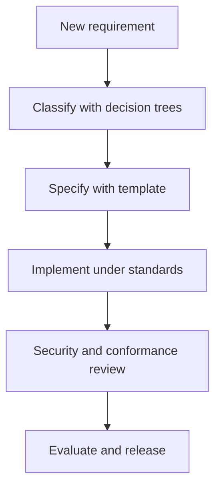

# Enterprise Agent Platform Standards

This package is the project-level source of truth for designing and reviewing an enterprise agent platform built from agents, MCP servers, tools, skills, deterministic code execution, a capability gateway, enterprise knowledge retrieval, an Agent Registry and Dependency Map, and evaluators.

It is intentionally runtime-neutral. The same standards can be used with Codex, Hermes, Agent Zero, or another agent runtime without redesigning the capability layer.

## Project goal

The goal of this project is to provide a reusable engineering and governance foundation for building an enterprise Agent Platform. The platform may contain agents, MCP servers, tools, skills, deterministic Code Mode execution, CLI access, an MCP Gateway, enterprise knowledge retrieval, a Result Store, an Agent Registry and Dependency Map, security and approval controls, observability, and evaluation.

The standards are designed so the agent runtime or model can be replaced without rebuilding the capability, security, knowledge, and governance layers. They can be applied to domains such as SQL Server, Oracle, Jira, KMS, and other enterprise systems.

## Why these files were created

These files give human developers and AI coding agents one consistent source of truth. They prevent important architecture and product decisions from being guessed separately during every implementation.

The package is intended to prevent common problems such as:

- Creating one MCP tool for every backend API endpoint
- Creating overlapping or duplicate tools
- Implementing a skill as one long prompt instead of a reusable workflow
- Using repeated model calls for deterministic loops, filtering, polling, joining, or aggregation
- Returning large raw backend datasets directly to model context
- Mixing diagnostic reads with hidden mutations
- Adding permissions, production access, or side effects without explicit approval
- Building unregistered, ownerless, unversioned, or unevaluated platform components
- Tying the platform to one model, framework, or agent runtime
- Implementing first and attempting to add security, observability, and evaluation afterward

The standards define the rules, the decision trees select the correct type of solution, the templates capture complete specifications, the prompts guide AI implementation and review, and the schemas/configuration examples make the rules machine-readable.

## Quick start: how to use this package

1. Extract the complete ZIP package into the root of the target repository.
2. Keep the full directory available to the coding agent. Do not send the files individually or copy only one prompt.
3. Ask the agent to read these two entry-point files first:
   - `AGENTS.md`
   - `00-IMPLEMENTATION_WORKFLOW.md`
4. Give the agent the initial prompt below together with the requested outcome.
5. Review and approve the classification and completed specification before allowing implementation.
6. Use the applicable creation prompt for MCP, Tool, or Skill implementation.
7. After implementation, run the matching independent review prompt and all required tests and evaluations.

### Initial prompt

```text
You are working in an enterprise agent-platform repository.

First, read AGENTS.md and 00-IMPLEMENTATION_WORKFLOW.md completely and follow
their instructions exactly.

Requested outcome:
<DESCRIBE WHAT MUST BE BUILT, ITS CONSTRAINTS, TARGETS, AND ACCEPTANCE CRITERIA>

Do not implement anything yet.

First:
1. analyze the requirement in implementation-neutral language;
2. search the Agent Registry, Dependency Map, Capability Catalog, repository,
   existing MCP servers, tools, skills, scripts, queries, resources, and ADRs;
3. determine whether the correct solution is reuse, Code Mode, ordinary code,
   MCP, Tool, Skill, agent reasoning, or a combination of them;
4. complete templates/CAPABILITY_REQUEST_TEMPLATE.md;
5. identify required permissions, side effects, risk class, approvals, evidence,
   output limits, Result Store behavior, tests, evaluations, Registry entries,
   dependencies, and failure/stop conditions;
6. ask only questions whose answers materially affect architecture, scope,
   authorization, target selection, or safety.

Wait for approval of the classification and specification before implementation.
```

### After the design is approved

Use the appropriate implementation prompt:

- MCP server: `prompts/CREATE_MCP.md`
- Tool: `prompts/CREATE_TOOL.md`
- Skill: `prompts/CREATE_SKILL.md`
- Other approved platform change: `prompts/IMPLEMENT_APPROVED_CHANGE.md`

### After implementation

Use the matching independent review prompt:

- MCP server: `prompts/REVIEW_MCP.md`
- Tool: `prompts/REVIEW_TOOL.md`
- Skill: `prompts/REVIEW_SKILL.md`

Fix accepted findings, rerun the affected tests and evaluations, and release only after all mandatory gates pass.

## What this package controls

- Architecture and separation of responsibilities
- MCP server and tool design
- Skill structure and dynamic loading
- Deterministic Code Mode execution
- Capability discovery and CLI access
- Gateway routing, authorization, and policy enforcement
- Agent, MCP, Tool, Skill, Model, Backend, ownership, lifecycle, and dependency governance
- Context management, hybrid KMS retrieval, and result storage
- Approval, audit, security, observability, and evaluation
- The decision process for choosing reuse, code, a tool, a skill, or agent reasoning

## Normative language

The terms **MUST**, **MUST NOT**, **SHOULD**, **SHOULD NOT**, and **MAY** are requirements levels:

- **MUST / MUST NOT**: mandatory for conformance.
- **SHOULD / SHOULD NOT**: expected unless a documented exception is approved.
- **MAY**: optional.

## Repository layout

```text
agent-platform-standards/
├── AGENTS.md
├── README.md
├── docs/agent-platform/
│   ├── 01-AGENT_PLATFORM_ARCHITECTURE.md
│   ├── 02-AGENT_ENGINEERING_PRINCIPLES.md
│   ├── 03-MCP_DESIGN_STANDARD.md
│   ├── 04-TOOL_DESIGN_STANDARD.md
│   ├── 05-SKILL_DESIGN_STANDARD.md
│   ├── 06-CODE_MODE_STANDARD.md
│   ├── 07-CAPABILITY_DISCOVERY_STANDARD.md
│   ├── 08-CLI_STANDARD.md
│   ├── 09-MCP_GATEWAY_STANDARD.md
│   ├── 10-RESULT_STORE_STANDARD.md
│   ├── 11-CONTEXT_MANAGEMENT_STANDARD.md
│   ├── 12-SECURITY_AND_APPROVAL_MODEL.md
│   ├── 13-OBSERVABILITY_STANDARD.md
│   ├── 14-EVALUATION_STANDARD.md
│   ├── 15-DECISION_TREES.md
│   └── 16-AGENT_REGISTRY_AND_DEPENDENCY_MAP_STANDARD.md
├── templates/
├── prompts/
├── schemas/
├── config/
└── examples/
```

## Recommended order of use

1. Put this package at the root of the implementation repository, or merge its `AGENTS.md` rules into the repository's root instructions.
2. Tailor the architecture's declared systems, trust boundaries, environments, and non-goals.
3. Search the Agent Registry, Capability Catalog, and repository for existing components.
4. Submit each requested capability through `templates/CAPABILITY_REQUEST_TEMPLATE.md`.
5. Apply `docs/agent-platform/15-DECISION_TREES.md` before creating anything.
6. Reuse an existing capability whenever possible.
7. If a new artifact is justified, apply its standard and complete the corresponding template.
8. Implement only after security, output-bound, Registry, and evaluation requirements are explicit.
9. Run conformance review, Registry validation, and evaluation before release.

## File index

### Standards

| File | Purpose |
|---|---|
| `01-AGENT_PLATFORM_ARCHITECTURE.md` | Components, boundaries, request lifecycle, and runtime portability |
| `02-AGENT_ENGINEERING_PRINCIPLES.md` | Mandatory cross-cutting engineering rules |
| `03-MCP_DESIGN_STANDARD.md` | MCP server boundaries, contracts, reliability, and release rules |
| `04-TOOL_DESIGN_STANDARD.md` | Tool admission, granularity, schemas, limits, and side effects |
| `05-SKILL_DESIGN_STANDARD.md` | Reusable workflow structure, safety, evidence, and versioning |
| `06-CODE_MODE_STANDARD.md` | Deterministic execution, sandbox, budgets, loops, and bulk work |
| `07-CAPABILITY_DISCOVERY_STANDARD.md` | Tool Search, catalog design, ranking, and dynamic loading |
| `08-CLI_STANDARD.md` | Python CLI interface, command contract, output, and exit behavior |
| `09-MCP_GATEWAY_STANDARD.md` | Central policy, routing, delegated access, quotas, and control |
| `10-RESULT_STORE_STANDARD.md` | Large-result storage, projection, access, integrity, and retention |
| `11-CONTEXT_MANAGEMENT_STANDARD.md` | Context budgets, KMS retrieval, memory separation, and injection resistance |
| `12-SECURITY_AND_APPROVAL_MODEL.md` | Capability security, action classes, approvals, and database safety |
| `13-OBSERVABILITY_STANDARD.md` | Traces, logs, metrics, audit, dashboards, and alerts |
| `14-EVALUATION_STANDARD.md` | Workflow and trace evaluation, datasets, hard gates, and regression |
| `15-DECISION_TREES.md` | Required classification paths before design or execution |
| `16-AGENT_REGISTRY_AND_DEPENDENCY_MAP_STANDARD.md` | Complete component inventory, ownership, lifecycle, topology, drift, and change impact |

### Templates

| File | Purpose |
|---|---|
| `CAPABILITY_REQUEST_TEMPLATE.md` | Capture a user outcome and record its decision-tree result |
| `MCP_TEMPLATE.md` | Specify a complete MCP server |
| `TOOL_TEMPLATE.md` | Specify one capability contract |
| `SKILL_TEMPLATE.md` | Scaffold a reusable skill package |
| `EVAL_TEMPLATE.md` | Define a versioned workflow evaluation suite |
| `ADR_TEMPLATE.md` | Record material architecture decisions and exceptions |
| `SECURITY_REVIEW_TEMPLATE.md` | Review identities, permissions, threats, and approvals |
| `AGENT_REGISTRATION_TEMPLATE.md` | Register an agent, deployments, ownership, dependencies, policy, and evaluation links |

### Prompts

| File | Purpose |
|---|---|
| `ASSESS_NEW_CAPABILITY.md` | Classify a requirement before implementation |
| `CREATE_MCP.md` | Implement an approved MCP server |
| `CREATE_TOOL.md` | Implement an approved tool |
| `CREATE_SKILL.md` | Build an approved skill package |
| `REVIEW_MCP.md` | Independently review an MCP server |
| `REVIEW_TOOL.md` | Independently review a tool |
| `REVIEW_SKILL.md` | Independently review a skill |
| `IMPROVE_SKILL_FROM_TRACES.md` | Produce a reviewed improvement proposal from trace data |
| `IMPLEMENT_APPROVED_CHANGE.md` | Implement a bounded approved platform change |

### Machine-readable assets and examples

| Folder | Contents |
|---|---|
| `schemas/` | Agent Registry, dependency, capability manifest, result, approval, audit, and evaluation schemas |
| `config/` | Example Agent Registry, capability catalog, gateway policy, and evaluation gates |
| `examples/` | Capability classification and SQL Server blocking worked examples |



## Required artifacts by change type

| Change | Required specification | Required review |
|---|---|---|
| New MCP server | `MCP_TEMPLATE.md` | MCP, security, observability, evaluation |
| New tool | `TOOL_TEMPLATE.md` | Tool, security, output bounds, evaluation |
| New skill | `SKILL_TEMPLATE.md` | Skill, permissions, trace evaluation |
| New platform component | `ADR_TEMPLATE.md` | Architecture and security |
| Modified behavior | Updated specification | Regression evaluation |
| Production mutation | Approval policy entry | Security and audit review |

## Core separation rule

| Component | Responsibility |
|---|---|
| MCP tool | What the system can do against a backend |
| Skill | How the agent should perform a reusable job |
| Code Mode | Deterministic iteration, filtering, joining, polling, and transformation |
| Agent | Interpretation, planning, judgment, and explanation |
| CLI | Stable command-line access to capabilities |
| Gateway | Authentication, authorization, policy, routing, quotas, and audit |
| Agent Registry | Authoritative inventory, ownership, lifecycle, versions, and declared/observed dependencies |
| Result Store | Large-result retention and controlled projection |
| KMS retrieval | Permission-aware evidence retrieval |
| Evaluator | Outcome and trace-quality assessment |

## Conformance

A change is conformant only when:

- Its classification is documented.
- Inputs, outputs, permissions, side effects, limits, and failure behavior are explicit.
- Raw unbounded backend data cannot enter model context.
- Mutations are default-denied unless an approved policy grants them.
- Evidence is distinguishable from inference.
- Tests and trace evaluations cover success, failure, safety, and adversarial cases.
- Audit records contain no secrets or prohibited content.
- The exact production component version and its dependencies are registered, owned, approved, and evaluated.

Local exceptions MUST be recorded in an architecture decision record with an owner, reason, risk, expiry or review date, and compensating controls.
