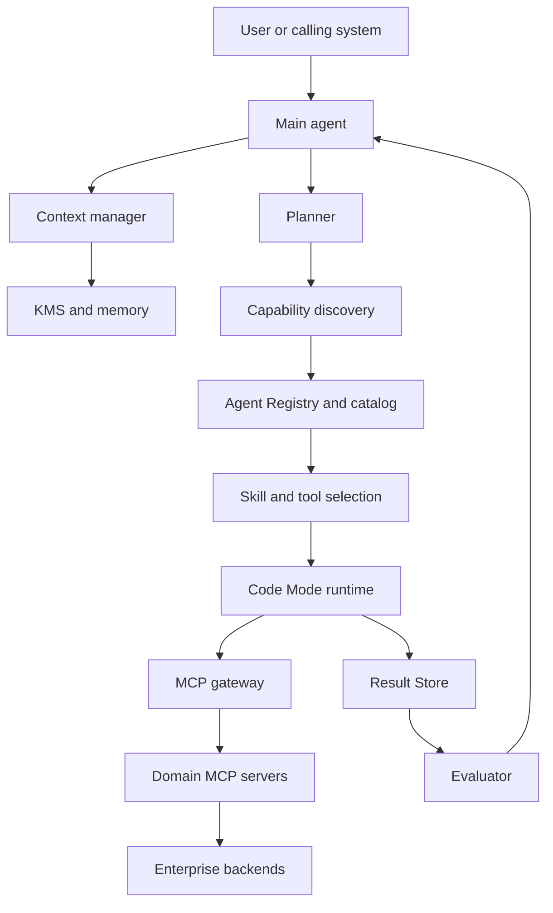

# Agent Platform Architecture

## 1. Purpose

This document defines the reference architecture for an enterprise agent platform that can change agent runtimes without rebuilding its tools, skills, security controls, or knowledge layer.

## 2. Architectural goals

The platform MUST:

- Support multiple business and infrastructure domains such as Jira, SQL Server, Oracle, and KMS.
- Keep capability contracts independent of a specific agent runtime or model provider.
- Keep large raw results outside model context.
- Select and load only the tools and skills relevant to the current task.
- Maintain an authoritative inventory of component ownership, versions, lifecycle, risk, and dependencies.
- Separate probabilistic reasoning from deterministic computation and protected execution.
- Preserve evidence, authorization decisions, and auditability across a complete workflow.
- Allow an evaluator to inspect both the final answer and the execution trace.

## 3. Non-goals

The platform is not:

- A direct mirror of every backend API.
- A mechanism for giving a model unrestricted backend credentials.
- A replacement for identity governance, change management, or database backup controls.
- A guarantee that model output is correct without evidence and evaluation.
- A single-runtime architecture tied to Hermes, Agent Zero, Codex, or any other agent host.

## 4. Logical architecture

Observability, security policy, approval, cost control, and audit surround every component and MUST share a workflow trace identifier.

## 5. Responsibilities

### 5.1 Main agent

The main agent interprets intent, identifies missing decisions, chooses a plan, requests relevant capabilities, distinguishes evidence from inference, and produces the final response. It MUST NOT implement deterministic loops through repeated model turns when Code Mode can do so safely.

### 5.2 Context manager

The context manager assembles only the instructions, conversation state, retrieved evidence, selected skill material, and compact tool outputs required for the current step. It enforces context budgets and prevents permission-incompatible retrieval.

### 5.3 Planner

The planner decomposes goals into bounded steps, identifies dependencies, declares evidence needs, marks side effects, and identifies which steps may execute concurrently. A plan is not authorization.

### 5.4 Capability discovery

Capability discovery searches a permission-aware catalog projected from approved Agent Registry entries rather than loading all schemas. It ranks tools and skills using task intent, domain, permissions, environment, risk, and evidence needs.

### 5.5 Agent Registry and Dependency Map

The Agent Registry is the control-plane system of record for agents, MCP servers, tools, skills, models, runtimes, gateways, endpoints, backends, knowledge sources, policies, owners, lifecycle state, and versions. The Dependency Map combines declared relationships with observed trace relationships to support discovery governance, drift detection, security review, and change-impact analysis.

### 5.6 Skills

Skills encode reusable procedures: triggers, ordered workflow, required capabilities, evidence rules, safety boundaries, stop conditions, and completion criteria. A skill MUST NOT contain long-lived secrets or silently grant permissions.

### 5.7 Code Mode runtime

Code Mode performs deterministic work such as iteration, polling, filtering, joining, aggregation, bulk calls, and format conversion in a constrained runtime. It receives explicit budgets and capabilities.

### 5.8 CLI

The CLI exposes discoverable, scriptable commands over the capability gateway. It is an invocation interface, not a second implementation of business logic.

### 5.9 MCP gateway

The gateway authenticates the caller, evaluates policy, routes versioned capability calls, applies quotas and limits, issues or brokers scoped credentials, records audit events, and connects large results to the Result Store.

### 5.10 Domain MCP servers

Each MCP server exposes coherent domain capabilities and translates stable platform contracts into backend-specific operations. Servers enforce validation and backend-specific safety in addition to gateway policy.

### 5.11 Result Store

The Result Store keeps raw or large outputs outside model context and returns an opaque reference plus a bounded summary. Subsequent computation accesses only authorized projections.

### 5.12 KMS and memory

- The KMS stores governed organizational knowledge and citations.
- Memory stores approved user or workflow continuity state.
- Runtime scratch state stores ephemeral intermediate values.

These stores MUST remain logically distinct and have separate retention and access rules.

### 5.13 Evaluator

The evaluator grades outcomes and traces: capability selection, unnecessary calls, evidence coverage, permission handling, side effects, hallucination, stop behavior, latency, and cost.

## 6. Control plane and data plane

| Plane | Contains | Rule |
|---|---|---|
| Control plane | Agent Registry, Dependency Map, catalog projections, policies, schemas, skill versions, evaluation gates, routing config | Versioned, reviewed, auditable |
| Data plane | User requests, tool calls, backend results, result references, generated responses | Least privilege, bounded, traceable |

Changing a control-plane artifact that alters permissions or side effects MUST follow the same review rigor as code.

## 7. Trust boundaries

At minimum, treat these as separate trust boundaries:

1. User to agent runtime.
2. Agent runtime to Code Mode sandbox.
3. Sandbox or CLI to gateway.
4. Gateway to MCP server.
5. MCP server to enterprise backend.
6. Platform to KMS, memory, Result Store, logs, and traces.

Every boundary MUST authenticate its caller or inherit a cryptographically verifiable delegated identity. User identity, service identity, and approval identity MUST remain distinguishable.

## 8. Reference request lifecycle

1. Authenticate the user and establish tenant, environment, and policy context.
2. Classify the request and its risk.
3. Retrieve minimal relevant knowledge and prior approved state.
4. Search the permission-aware Capability Catalog projected from approved Agent Registry entries and load only selected skill/tool definitions.
5. Produce a bounded plan with declared evidence requirements.
6. Obtain approval before protected mutations.
7. Execute deterministic orchestration in Code Mode where appropriate.
8. Route calls through the gateway and store large results by reference.
9. Evaluate evidence sufficiency and policy compliance.
10. Return a concise answer with sources, uncertainty, and any proposed next action.

## 9. Portability rules

- Capability names, input/output contracts, and policy semantics MUST NOT depend on one model vendor.
- Runtime adapters MAY translate platform calls to a host-specific tool mechanism.
- Skills SHOULD use platform capability identifiers rather than SDK-specific method names.
- Backend adapters SHOULD isolate Jira, SQL Server, Oracle, KMS, and other product-version differences.
- Replacing an agent runtime MUST NOT require changing backend credentials or duplicating domain logic.

## 10. Required deployment separation

Production and non-production MUST use separate credentials, policy scopes, result storage, audit streams, and configuration. A command MUST declare its target environment; production MUST never be inferred from an ambiguous default.

## 11. Architecture change control

Create an ADR when a change:

- Introduces a new platform component or trust boundary.
- Bypasses the gateway, Result Store, approval flow, Agent Registry, or capability catalog.
- Changes how identity or credentials are delegated.
- Adds a new mutation class.
- Alters retention, audit, or model-context exposure.
- Creates a runtime-specific dependency in a stable platform contract.
- Changes a declared data-flow or dependency relationship with material security, compatibility, or blast-radius impact.
