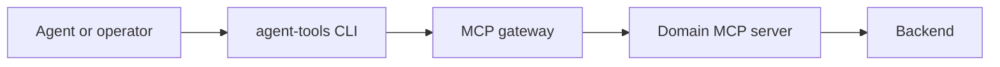

# CLI Standard

## 1. Definition

CLI means **Command-Line Interface**. It is an invocation interface, not a file type. For this platform the recommended implementation is an installable Python application that exposes stable commands and calls the MCP gateway.

Example:

```bash
agent-tools sqlserver blocking --instance PROD01 --output json
```

The installed command may be implemented in Python, but callers should not need to run a source filename directly.

## 2. Role in the architecture



The CLI gives agents and deterministic scripts a small, discoverable interface without loading hundreds of tool schemas into model context. It MUST NOT bypass the gateway or duplicate backend business logic.

## 3. Command model

Use a predictable hierarchy:

```text
agent-tools <domain> <resource-or-workflow> <action> [options]
```

Examples:

```bash
agent-tools sqlserver blocking get --instance PROD01 --output json
agent-tools jira issues search --jql-file query.txt --limit 100 --output json
agent-tools kms documents get --id DOC-123 --output json
agent-tools capabilities search --query "database blocking" --output json
```

Names SHOULD map to stable capability identifiers. Do not expose a separate CLI command for every fixed filter.

## 4. Output streams

- Structured result data goes to standard output.
- Diagnostics, warnings, and progress go to standard error.
- `--output json` MUST produce machine-readable JSON without decorative text.
- Human-readable output MAY be offered for operators but MUST not be the agent integration contract.
- Large results MUST return a Result Store reference instead of printing raw data.

## 5. Exit codes

At minimum:

| Code | Meaning |
|---:|---|
| 0 | Complete success |
| 2 | Invalid invocation or validation failure |
| 3 | Authentication failure |
| 4 | Authorization or policy denial |
| 5 | Approval required or expired |
| 6 | Target not found or ambiguous |
| 7 | Backend unavailable or dependency failure |
| 8 | Timeout or cancellation |
| 9 | Partial success |
| 10 | Conflict or stale precondition |
| 11 | Unknown mutation outcome |
| 12 | Internal platform error |

The JSON error envelope remains authoritative; exit codes provide coarse automation behavior.

## 6. Authentication

- Prefer delegated short-lived identity or workload identity.
- Do not accept secrets directly on the command line because process listings and shell history may expose them.
- Tokens MUST NOT be printed in help, errors, debug output, or traces.
- Interactive login MAY be supported for humans; agents MUST use an approved noninteractive delegated flow.

## 7. Target and environment safety

- Production MUST be explicit.
- Commands that mutate MUST display or return the resolved target and action preview before approval.
- Ambiguous names MUST fail with candidate identifiers rather than choosing silently.
- A global `--dry-run` flag MAY be offered only where the backend operation can be accurately previewed.

## 8. Input safety

Prefer structured options or input files over complex shell quoting. Validate file size, encoding, schema, and allowed path. Do not pass arbitrary SQL, shell, template, or URL content unless the specific capability is designed and approved for it.

## 9. Discovery and help

The CLI MUST support:

- `agent-tools --version`
- `agent-tools capabilities search`
- `agent-tools capabilities describe <id>`
- Command-specific `--help`
- Machine-readable schema or description output

Help MUST indicate risk class, permissions, approval needs, supported environments, limits, and examples.

## 10. Pagination and bulk work

CLI commands MUST expose cursors and page limits when the underlying capability is paginated. Code Mode, not the model, SHOULD follow cursors for bulk workflows. Bounded concurrency and failure reporting are mandatory.

## 11. Mutations

A mutation command MUST accept an idempotency key when the capability supports retry and MUST carry an approval reference when required. The CLI MUST not implement a `--force` switch that bypasses policy.

## 12. Configuration precedence

Use explicit precedence and document it:

1. Command options
2. Approved environment-specific configuration
3. User configuration
4. Built-in safe defaults

Secrets are never ordinary configuration values. Production must not be a built-in default.

## 13. Versioning

CLI release version and capability contract versions are separate. The CLI MUST negotiate or reject incompatible capability versions and SHOULD warn before removal of deprecated commands.

## 14. Python implementation guidance

The Python package SHOULD expose a console entry point named `agent-tools`, use typed request/response models, keep transport in a gateway client module, and keep formatting separate from domain contracts. Shell scripts or batch files MAY wrap installation or environment setup but SHOULD NOT contain core capability logic.

## 15. Testing

Test command parsing, exact JSON output, exit codes, stdout/stderr separation, secret redaction, environment ambiguity, authentication, policy denial, approval flow, timeouts, pagination, Result Store references, version mismatch, and shell-injection resistance.

## 16. Registry requirements

Production CLI releases MUST be registered with an owner, exact version, supported gateway and capability-contract versions, environments, policy/evaluation references, and declared gateway dependencies. Runtime traces SHOULD identify the CLI Registry ID/version so observed invocation relationships can be reconciled without logging command-line secrets or sensitive arguments.
