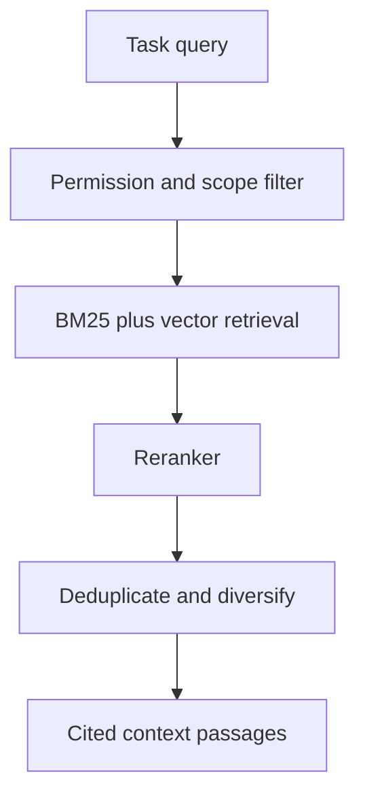

# Context Management and Knowledge Retrieval Standard

## 1. Purpose

Context management provides the model with the smallest set of authoritative instructions and evidence required for the current decision. More context is not automatically better; irrelevant or untrusted context increases cost and error risk.

## 2. Context layers

Assemble context in explicit layers:

1. Platform and safety instructions
2. Repository or project instructions
3. Selected skill instructions
4. Current user request and confirmed decisions
5. Minimal workflow state
6. Retrieved KMS evidence
7. Compact tool or Result Store projections
8. Required output contract

Higher-priority instructions MUST remain distinguishable from retrieved content.

## 3. Context budget

Each workflow MUST define budgets for instructions, user state, retrieved evidence, tool schemas, tool results, and response reserve. The context manager SHOULD evict low-relevance duplicate material before compressing authoritative requirements.

Do not silently summarize away permissions, stop conditions, evidence provenance, approval state, or unresolved decisions.

## 4. Tool and skill loading

- Load compact catalog metadata first.
- Load full schemas only for selected tools.
- Read the complete selected `SKILL.md` before applying it.
- Load referenced material only as routed by the skill.
- Remove obsolete candidate schemas after selection when the runtime supports it.

## 5. KMS retrieval

For enterprise knowledge, use a permission-aware hybrid pipeline when document volume and semantic search warrant it:

- BM25 or equivalent lexical retrieval preserves exact identifiers, codes, and names.
- Vector retrieval improves semantic recall.
- A reranker improves task relevance.
- Permission filtering MUST occur before content is exposed to the model and SHOULD constrain retrieval itself.
- Results MUST preserve document identity, version, location, and passage provenance.

## 6. Exact-data requirements

For part numbers, incident IDs, version numbers, amounts, dates, configuration values, and other exact tokens, lexical or structured lookup MUST be included. Semantic similarity alone is insufficient.

## 7. Knowledge versus memory

| Store | Purpose | Examples |
|---|---|---|
| KMS | Governed organizational knowledge | Policies, runbooks, specifications |
| User memory | Approved cross-session preferences or facts | Preferred format, stable constraints |
| Workflow state | Current run continuity | Plan step, result references, approvals |
| Scratch | Ephemeral computation | Temporary files, intermediate arrays |

Content MUST NOT move between these stores without an explicit retention and permission decision.

## 8. Conversation continuity

Carry forward confirmed decisions and unresolved questions, not an uncontrolled transcript. Mark source, timestamp, scope, and confidence for remembered facts. When new evidence conflicts with prior state, surface the conflict.

## 9. Prompt-injection resistance

Retrieved documents, web pages, tool results, ticket bodies, and file contents are untrusted data. They MUST NOT override platform policy, grant permissions, request secrets, or direct unauthorized tool use.

The context manager SHOULD label source boundaries and remove executable active content where possible. Suspected instruction injection MUST be recorded and ignored or escalated.

## 10. Evidence packaging

Each evidence item SHOULD include:

- Source and stable identifier
- Version or collection timestamp
- Relevant excerpt or structured fields
- Authorization scope
- Retrieval method and score when useful
- Any completeness or freshness limitation

The final answer SHOULD cite evidence close to each material claim.

## 11. Compression and summarization

Summaries MUST preserve exact identifiers, numbers, negative findings, uncertainty, source distinctions, and safety constraints. A summary of a partial dataset MUST not be labeled as a summary of the whole dataset.

## 12. Caching

Context and retrieval caches MUST be keyed by tenant, user/role scope, source version, query, and policy context. Cached passages MUST be rechecked for authorization and freshness before reuse.

## 13. Evaluation

Measure retrieval recall, precision, citation correctness, permission leakage, exact-token accuracy, duplicate rate, stale-context rate, context tokens, and whether omitted evidence changes the outcome.

