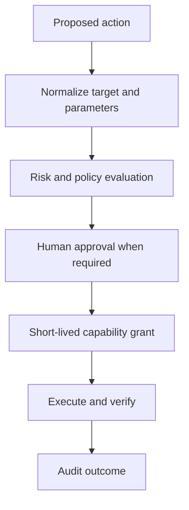

# Security and Approval Model

## 1. Security objective

No agent, skill, script, CLI command, gateway, or MCP server receives more capability, data, time, or scope than required for the authorized task. Security decisions are enforced outside model reasoning.

## 2. Threat model

At minimum address:

- Prompt injection in user or retrieved content
- Excessive agency and confused-deputy behavior
- Credential or sensitive-data exposure
- Unauthorized production access
- Cross-tenant or cross-environment leakage
- Tool output poisoning and untrusted backend content
- Arbitrary SQL, shell, URL, path, or template injection
- Replay, stale approval, and idempotency failures
- Result-reference guessing or reuse
- Destructive actions and excessive blast radius
- Supply-chain compromise in skills, packages, models, and MCP servers
- Denial of service and cost exhaustion

## 3. Capability-based access

Prefer capabilities scoped by:

- Exact operation and contract version
- User and agent/workload identity
- Tenant, environment, server, project, database, or resource
- Read/write risk class
- Parameter constraints
- Call, time, row, byte, and cost limits
- Approval reference

Broad backend credentials SHOULD remain behind the gateway or domain service and be exchanged for short-lived scoped access.

Production execution through unmanaged, ownerless, disabled, retired, incompatible, or unapproved Registry components MUST be denied by default.

## 4. Policy model

Use explicit deny-overrides semantics. Policy SHOULD combine roles/groups with resource and request attributes. Required inputs include user identity, tenant, environment, capability, target, risk class, parameters, network zone, workflow purpose, and approval state.

The final authorization decision MUST be made after concrete target resolution.

## 5. Action classes

| Class | Example | Default handling |
|---|---|---|
| R0 | Capability metadata | Authenticated, scoped |
| R1 | Ordinary business read | Permission required |
| R2 | Production or sensitive diagnostic read | Elevated read, audit, tighter limits |
| W1 | Reversible low-impact update | Permission; approval by policy |
| W2 | Material/external state change | Exact preview, human approval, verify |
| W3 | Destructive/high-impact action | Default deny; exceptional controlled process |

Organizations MAY make rules stricter. They MUST NOT silently weaken these defaults.

## 6. Approval lifecycle

Approval MUST bind to:

- Requester and approver identities
- Capability and contract version
- Resolved target and environment
- Normalized parameters and expected side effects
- Action digest
- Validity window and maximum uses
- Preconditions and optional change/ticket reference

Any material change requires new approval.

## 7. Human approval requirements

Human approval is mandatory for W2 and W3 unless a formally reviewed, narrow pre-approval policy specifies exact bounds. The requester SHOULD NOT self-approve sensitive actions when separation of duties applies.

Conversational consent does not replace a required formal approval artifact.

## 8. Credentials and secrets

- Never place secrets in prompts, tool arguments, source control, result objects, logs, or error messages.
- Use a managed secret broker, workload identity, or delegated token service.
- Rotate and revoke credentials independently of models and skills.
- Scope credentials by environment and domain.
- Detect and redact accidental secret output.
- Do not ask the model to transform or relay credentials.

## 9. Database safety baseline

For ordinary SQL Server or Oracle diagnostic agents:

- Allow reviewed read-only DMV/catalog/query capabilities required for diagnosis.
- Deny arbitrary DDL, DML, login/role changes, `KILL`, failover, restore, service control, and configuration change.
- Generate safe T-SQL or PowerShell instructions as a separate proposed artifact when requested; do not execute them through a diagnostic capability.
- Parameterize inputs and restrict accessible databases, schemas, views, and procedures.
- Enforce query timeout, row limit, and resource governance.

If execution of remediation is later required, expose distinct mutation capabilities with their own policy and approval flow.

## 10. Untrusted content

Treat documents, ticket comments, emails, web content, database strings, logs, and tool output as data, not instructions. Never follow embedded requests to reveal secrets, change policy, call tools, or contact recipients.

## 11. Data protection

- Classify data and propagate classification through derived results.
- Apply field-level minimization and redaction before model context.
- Separate tenants and production/non-production stores.
- Define residency, retention, deletion, export, and backup rules.
- Avoid sending regulated or restricted data to models not approved for it.

## 12. Network and runtime controls

Use egress allowlists, filesystem boundaries, package allowlists, execution budgets, non-root runtime identities, and isolated workloads. Code Mode and MCP servers MUST not gain general network access merely because one endpoint is required.

## 13. Audit requirements

Record security decisions, approvals, capability grants, mutations, sensitive reads, result exports, policy changes, and emergency actions. Audit records MUST be tamper-evident, access-controlled, time-synchronized, and retained according to policy.

## 14. Break-glass access

Break-glass access MUST be separately authenticated, time-limited, narrowly scoped, highly visible, fully audited, and reviewed after use. It MUST NOT be a hidden fallback used when normal authorization fails.

## 15. Incident response and kill switches

The platform MUST support rapid disablement of a capability, server, credential, model route, skill version, tenant, or environment. Owners and escalation paths MUST be documented and tested.

Emergency disablement SHOULD update or override Registry lifecycle and catalog visibility atomically enough to prevent continued ordinary discovery and routing.

## 16. Security tests

Test positive and negative authorization, deny precedence, approval binding/replay/expiry, tenant isolation, target ambiguity, injection, secret leakage, oversized output, arbitrary command/query attempts, Result Store access, dependency compromise assumptions, and W2/W3 failure recovery.
