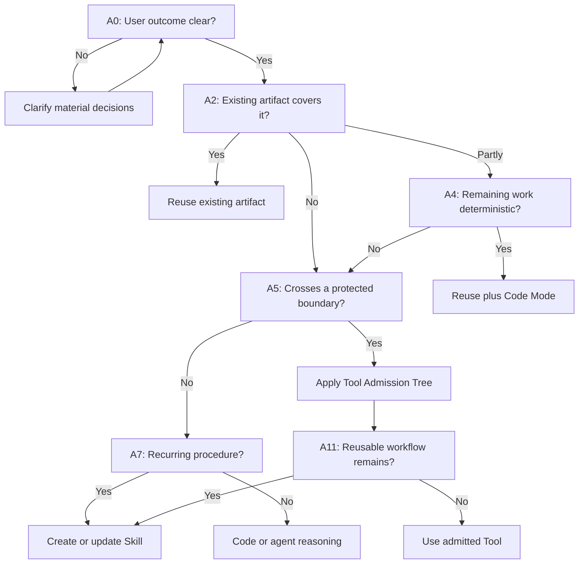
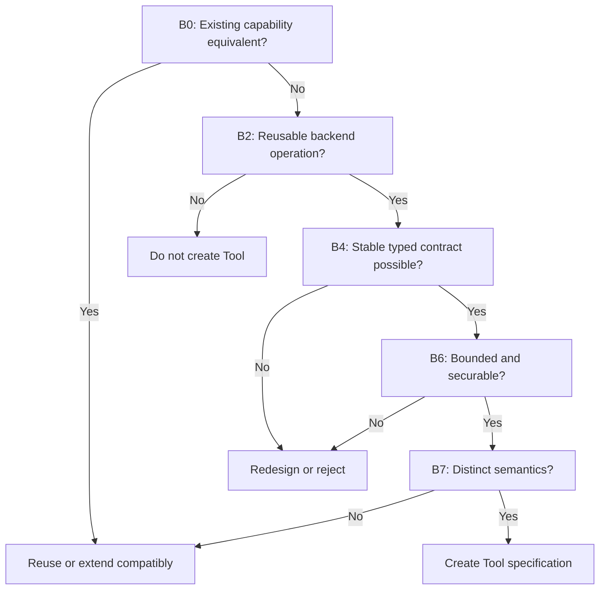
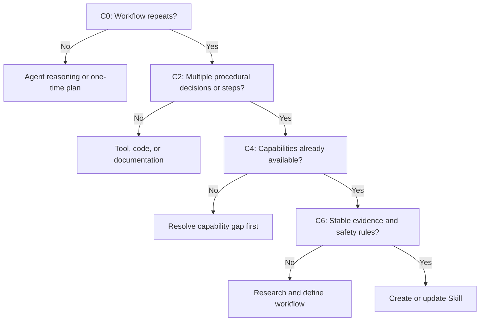
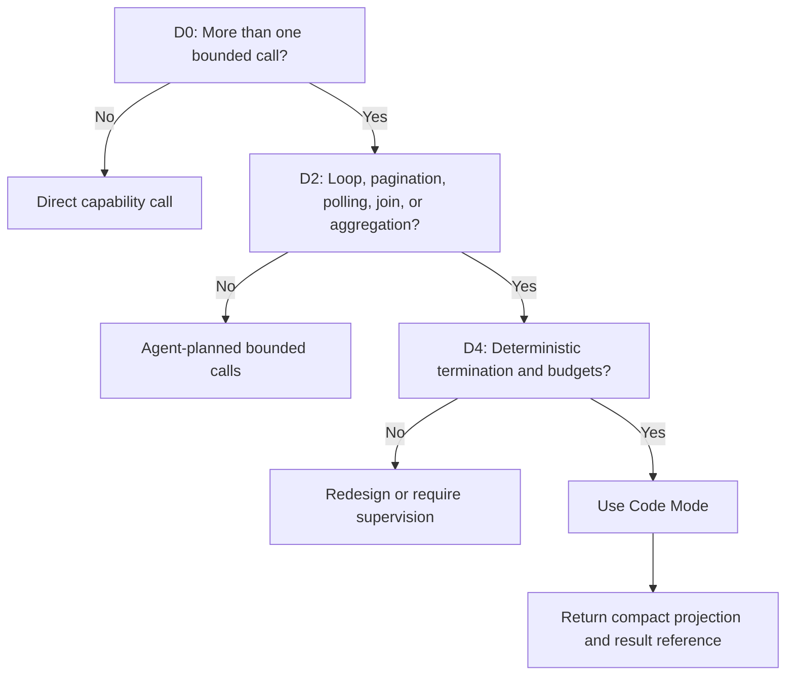
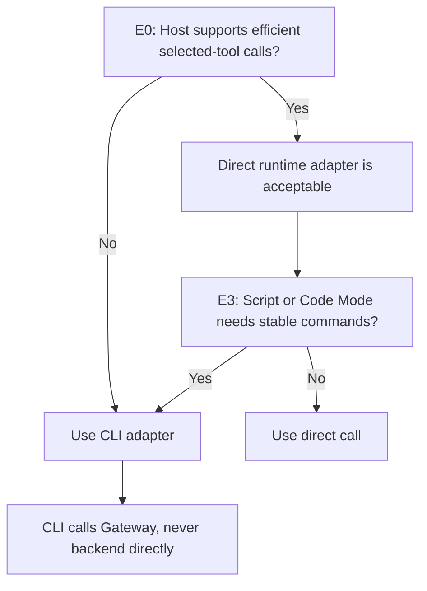
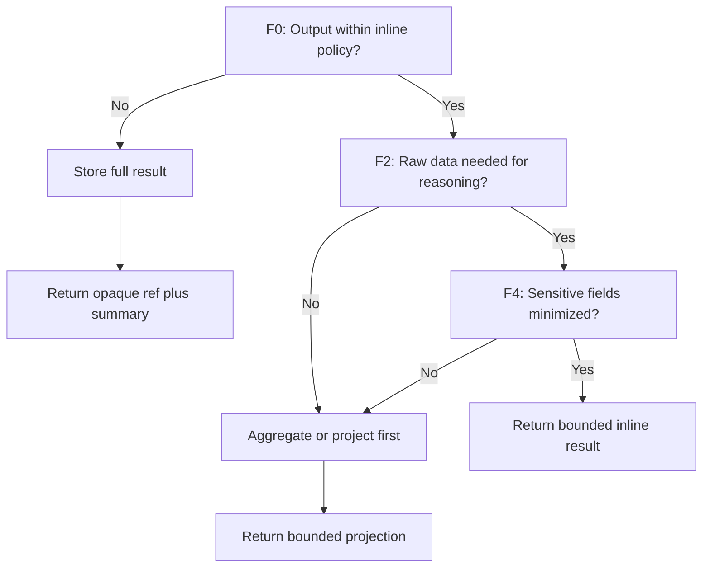
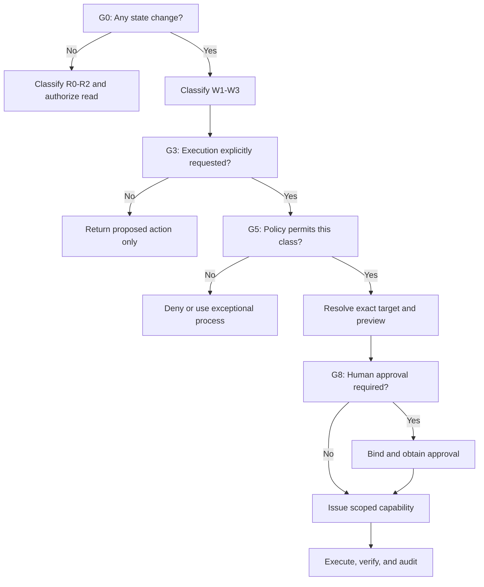
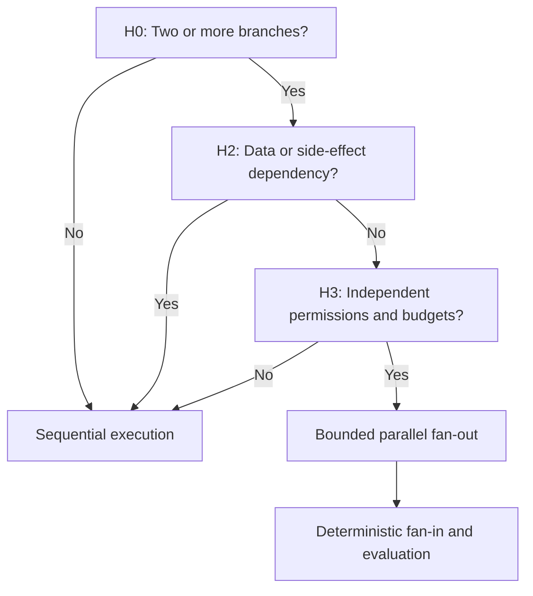
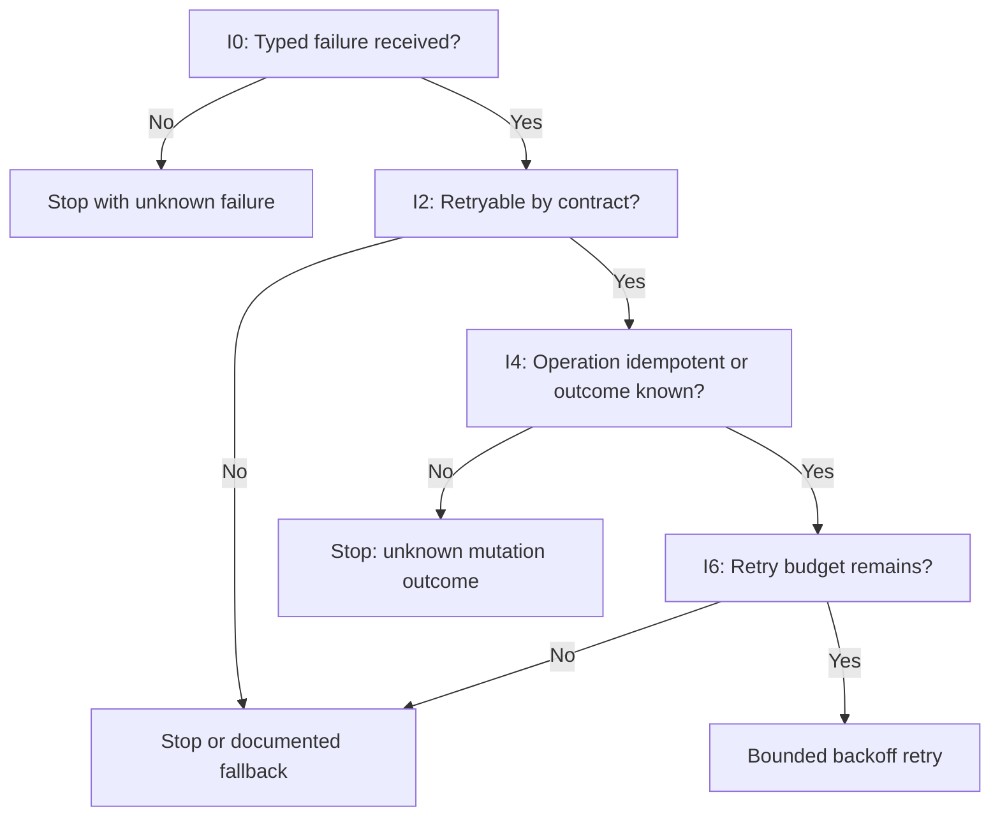

# Agent Platform Decision Trees

## 1. Purpose

This document is the mandatory classification gate for every new agent-platform requirement. It determines whether to:

- Reuse an existing artifact
- Use deterministic Code Mode or ordinary application code
- Create or update an MCP tool
- Create or update a skill
- Use agent reasoning only
- Use CLI or a direct runtime adapter to invoke capabilities
- Store and project a result
- Require approval, stop, or reject the request

It answers **what should be built or selected**. The other standards answer **how it must be built**.

## 2. Important interpretation rule

The result is not always one artifact. Classify each responsibility separately.

For example, SQL Server blocking diagnosis can correctly use:

- A tool to collect protected backend evidence
- Code Mode to build and sort the blocking graph
- A skill to encode the reusable diagnostic procedure
- Agent reasoning to interpret evidence and explain uncertainty
- CLI as an efficient invocation interface
- Gateway for authorization and routing

Do not force the whole job into one opaque tool or one long prompt.

## 3. Mandatory preconditions

Before entering any tree:

1. Express the requested **user outcome** without naming an implementation.
2. Identify domain, targets, environment, data sensitivity, and possible side effects.
3. Resolve only questions whose answers materially change scope, architecture, authorization, or safety.
4. Search the Agent Registry, its Capability Catalog projection, repository, skills, scripts, queries, and ADRs.
5. Inspect incoming and outgoing dependency relationships for any component to be changed or reused.
6. Record the path and answers in `templates/CAPABILITY_REQUEST_TEMPLATE.md`.

If the target, environment, recipient, destructive scope, or required authority is ambiguous, stop before design or execution.

---

# Tree A — Classify the capability



## A0 — Is the user outcome clear?

**Yes** only when success, target type, environment, scope, output, and side-effect expectations are sufficiently clear.

Ask only material questions. Do not ask the user to decide routine implementation details already controlled by standards.

## A2 — Does an existing artifact cover it?

Search by semantics and stable Registry identity, not only names. Compare:

- Contract and supported versions
- Required evidence
- Security and side effects
- Limits and freshness
- Output semantics
- Lifecycle state, ownership, declared dependencies, observed use, and compatibility impact

If coverage is complete, reuse. If only deterministic filtering, aggregation, joining, pagination, or polling remains, reuse plus Code Mode.

## A5 — Does the missing operation cross a protected boundary?

Examples include backend access, privileged data, external system calls, controlled files, enterprise identities, or state changes. If yes, apply Tree B. If no, ordinary application code may be sufficient.

## A7 — Is it a recurring procedure?

A recurring evidence-driven procedure with steps, tools, safety rules, and a stable output contract is a skill. A one-time interpretation with all evidence already present is agent reasoning.

---

# Tree B — Admit or reject a new MCP tool



A new tool is admitted only when all answers B2, B4, B6, and B7 are **Yes**.

## B2 — Reusable backend operation

The operation should be useful in multiple workflows and belong behind a backend, process, privilege, or trust boundary.

Not sufficient:

- One fixed threshold over existing data
- One UI filter
- One-off formatting
- An endpoint exists
- A prompt would be shorter with a new tool

## B4 — Stable typed contract

Inputs, outputs, errors, versions, units, identifiers, completeness, and side effects must be expressible without depending on one prompt or model.

## B6 — Bounded and securable

The operation must support least privilege, target scoping, hard size/time limits, audit, and approval when applicable. Reject generic unrestricted SQL, shell, URL fetch, or backend-command tools for ordinary use.

## B7 — Distinct semantics

Do not add aliases whose only difference is a fixed filter. Extend a compatible existing tool or use Code Mode.

---

# Tree C — Decide whether to create a skill



Create a skill when the job is reusable and benefits from explicit triggers, evidence requirements, ordered workflow, safety constraints, stop conditions, and output criteria.

Do not use a skill to disguise a missing protected capability or to hold secrets.

---

# Tree D — Direct call or Code Mode



Use Code Mode when the same result can be produced more reliably by deterministic execution than by repeated model turns. Code Mode does not bypass permissions or approvals.

Examples:

- Follow 20 pagination cursors: Code Mode.
- Filter 500 databases by backup age: Code Mode.
- Call one bounded blocking snapshot tool: direct call.
- Choose which evidence is relevant to an unusual incident: agent reasoning, then deterministic collection as applicable.

---

# Tree E — CLI or direct runtime tool call

CLI is not an alternative to MCP tool design. It is one way to invoke the same gateway capability.



Prefer the CLI when:

- The agent runtime would otherwise load many schemas.
- Code Mode or operational scripts need stable machine-readable commands.
- Operators and agents benefit from one consistent invocation surface.
- Runtime portability is important.

Prefer direct selected-tool calls when the host already provides dynamic discovery, schema loading, policy propagation, and bounded invocation efficiently.

Both routes MUST use the same capability ID, policy, gateway, Result Store, audit, and contract semantics.

---

# Tree F — Inline output or Result Store



Store the result if any hard row, byte, token, sensitivity, reuse, or retention threshold is exceeded. Possession of a reference is not authorization.

Never hide truncation or sampling. Exact completeness state must accompany every result.

---

# Tree G — Read, propose, approve, or execute



Rules:

- A request for analysis or instructions is not authorization to execute.
- Diagnostic SQL skills remain read-only and may generate safe T-SQL or PowerShell instructions as **not executed**.
- W2 requires exact preview and human approval unless a narrow pre-approved policy exists.
- W3 is default-denied and uses an exceptional controlled process.
- If target or outcome is ambiguous, stop.

---

# Tree H — Sequential or parallel execution



Parallelism is justified by independent work, not by the desire to use more agents. Mutating branches with ordering or shared-state risks SHOULD remain sequential unless concurrency semantics are explicit.

---

# Tree I — Retry, stop, or escalate



The agent MUST NOT improvise repeated calls after an unknown mutation outcome. A fallback must preserve security and semantics; a weaker unauthorized route is not a fallback.

---

# 4. Decision table

| Situation | Correct primary classification | Common wrong choice |
|---|---|---|
| Reusable protected backend fact | MCP tool | Prompt-only access |
| Reusable expert workflow | Skill | One giant tool |
| Loop/filter/join/aggregation | Code Mode | Repeated LLM tool calls |
| One-off interpretation with supplied evidence | Agent reasoning | New skill/tool |
| Stable script/operator interface | CLI over gateway | Direct backend script with credentials |
| Large or sensitive output | Result Store plus projection | Raw payload in context |
| Material state change | Mutation tool plus policy/approval | Hidden write in diagnostic tool |
| Independent evidence branches | Bounded parallel fan-out/fan-in | Parallelism with shared mutation state |

# 5. Required decision record

For every capability request, record:

```text
Outcome:
Domain/target/environment:
Read/write risk class:
Existing artifacts searched:

Tree path:
- A0: Yes — ...
- A2: Partly — existing capability ... covers ...
- A4: Yes — remaining filtering is deterministic
- Decision: reuse + Code Mode

Artifacts to create or update:
Registry components and relationships to create or update:
Permissions and approvals:
Output/result handling:
Evidence requirements:
Failure/stop rules:
Alternatives rejected:
Open decisions:
Reviewers:
```

A decision without recorded Registry, dependency, repository, and catalog search is incomplete.

# 6. Worked decisions

## 6.1 Count active SQL Server sessions

- A0: Clear after exact instance/environment is known.
- A2: If `sqlserver.list_sessions` already returns status, reuse it and count in Code Mode.
- If no relevant capability exists: B2/B4/B6/B7 may admit a bounded read tool.
- No skill is needed for a single fact.

## 6.2 Diagnose transaction-log growth

Assume tools already expose log usage, log reuse wait, active transactions, and backup status.

- A2: Partly/collectively covered.
- A4: Correlation calculations use Code Mode.
- A7: The evidence-driven diagnosis recurs, so create a skill.
- Decision: reuse tools + Code Mode + skill; no new tool.

## 6.3 Check backup compliance across 500 databases

- Reuse `sqlserver.get_backup_status`.
- Use Code Mode for pagination, bounded concurrency, age calculation, filtering, and aggregation.
- Store the complete dataset; return only exceptions and summary.
- Create a skill only if the compliance workflow, evidence, and output policy recur.
- Do not create `get_old_backups` or one tool per threshold.

## 6.4 Execute `KILL` on a production blocker

- This is not part of a read-only diagnosis skill.
- Classify as a separate W2 or W3 capability according to organizational impact policy.
- Require exact session/instance resolution, current-state revalidation, business impact preview, formal approval, scoped short-lived access, execution verification, and audit.
- If such a capability and policy have not been explicitly approved, return instructions or deny execution.

## 6.5 Explain a supplied error message

- If the message and required context are already supplied, use agent reasoning.
- Retrieve documentation only when necessary and authorized.
- Do not create a tool or skill for a one-off explanation.

# 7. Final gate checklist

Before approving the classification:

- [ ] The outcome is implementation-neutral.
- [ ] Existing artifacts were actually searched.
- [ ] Registry ownership, lifecycle, version, and direct/transitive dependency impact were checked.
- [ ] The result is the smallest correct abstraction.
- [ ] Deterministic work is assigned to code.
- [ ] Protected backend access is assigned to a bounded capability.
- [ ] Reusable procedure is assigned to a skill only when justified.
- [ ] CLI is treated as invocation, not duplicated business logic.
- [ ] Large data is assigned to the Result Store.
- [ ] Risk, permissions, approval, evidence, limits, and stop behavior are explicit.
- [ ] No read operation hides a mutation.
- [ ] The design remains portable across agent runtimes.
- [ ] New or changed production components will be registered before activation.
